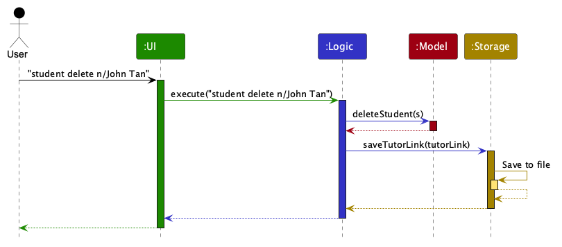
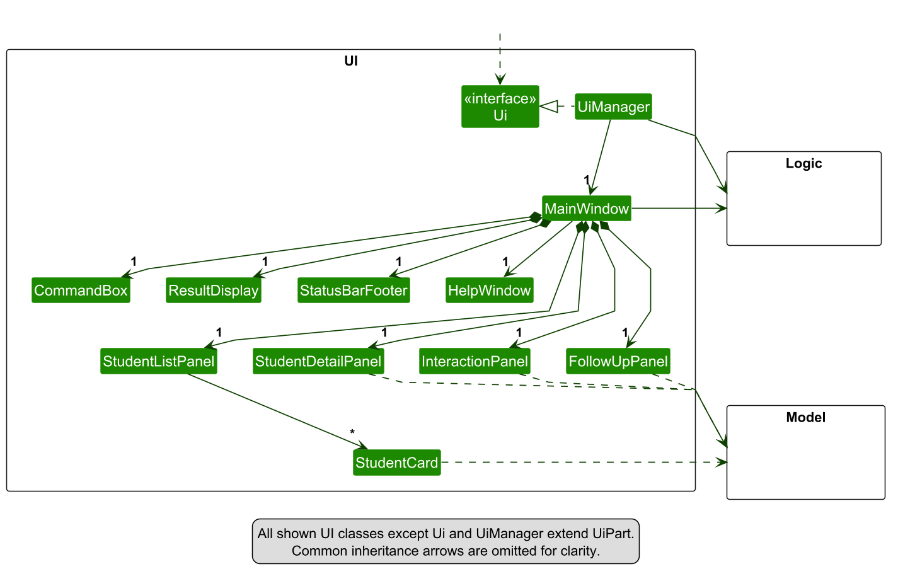
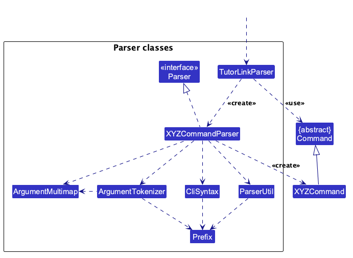
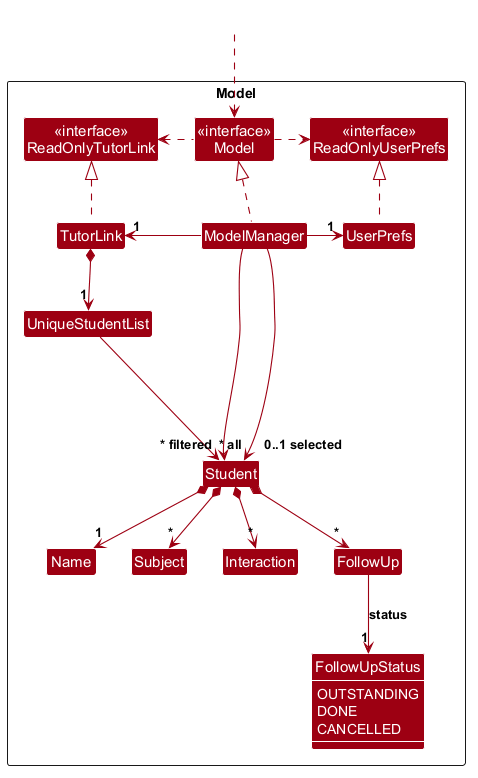
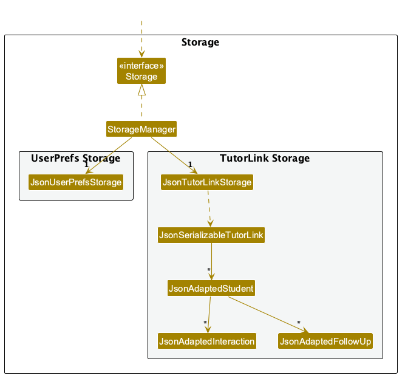
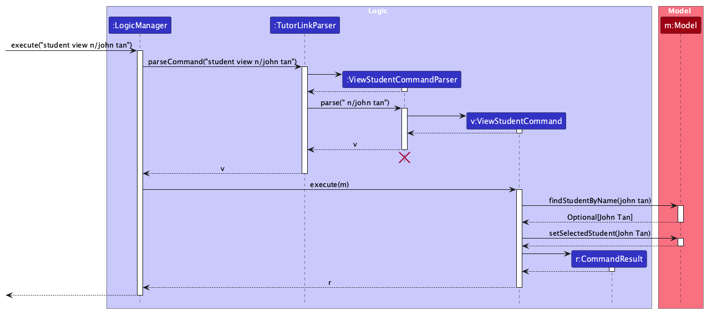
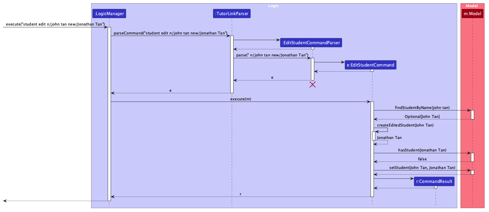

* Table of Contents
{:toc}

--------------------------------------------------------------------------------------------------------------------

## **Acknowledgements**

* _{List the sources of reused or adapted ideas, code, documentation, and third-party libraries here, with links to the originals.}_

--------------------------------------------------------------------------------------------------------------------

## **Setting up, getting started**

Refer to the guide [_Setting up and getting started_](SettingUp.md).

--------------------------------------------------------------------------------------------------------------------

## **Design**

:bulb: **Tip:** The `.puml` files used to create diagrams are in `docs/diagrams`. Refer to the [_PlantUML Tutorial_ at se-edu/guides](https://se-education.org/guides/tutorials/plantUml.html) to learn how to create and edit diagrams.

### Architecture

The ***Architecture Diagram*** given above explains the high-level design of the App.

The following provides a quick overview of the main components and their interactions.

**Main components of the architecture**

**`Main`** (consisting of classes [`Main`](https://github.com/AY2627S1-CS2103-F12-2/tp/tree/master/src/main/java/seedu/tutorlink/Main.java) and [`MainApp`](https://github.com/AY2627S1-CS2103-F12-2/tp/tree/master/src/main/java/seedu/tutorlink/MainApp.java)) is in charge of the app launch and shut down.
* At app launch, it initializes the other components in the correct sequence, and connects them up with each other.
* At shut down, it shuts down the other components and invokes cleanup methods where necessary.

The bulk of the app's work is done by the following four components:

* [**`UI`**](#ui-component): The UI of the App.
* [**`Logic`**](#logic-component): The command executor.
* [**`Model`**](#model-component): Holds the data of the App in memory.
* [**`Storage`**](#storage-component): Reads data from, and writes data to, the hard disk.

[**`Commons`**](#common-classes) represents a collection of classes used by multiple other components.

**How the architecture components interact with each other**

The *Sequence Diagram* below shows how the components interact with each other for the scenario where the user issues the command `student delete n/John Tan`.

Each of the four main components (also shown in the diagram above),

* defines its *API* in an `interface` with the same name as the Component.
* provides its functionality through a concrete `{Component Name}Manager` class that implements the corresponding API interface.

For example, the `Logic` component defines its API in `Logic.java` and implements it in `LogicManager.java`. Other components interact with a component through its interface rather than its concrete class, preventing them from coupling to that component's implementation, as illustrated in the following partial class diagram.

The sections below give more details of each component.

### UI component

The **API** of this component is specified in [`Ui.java`](https://github.com/AY2627S1-CS2103-F12-2/tp/tree/master/src/main/java/seedu/tutorlink/ui/Ui.java)

The UI consists of a `MainWindow` and its parts, such as `CommandBox`, `ResultDisplay`, `StudentListPanel`, `StudentDetailPanel`, `InteractionPanel`, `FollowUpPanel` and `StatusBarFooter`. All of these, including `MainWindow`, inherit from the abstract `UiPart` class, which captures common behavior among classes that represent visible GUI parts.

The `UI` component uses the JavaFX UI framework. The layouts of these UI parts are defined in matching `.fxml` files in `src/main/resources/view`. For example, [`MainWindow.fxml`](https://github.com/AY2627S1-CS2103-F12-2/tp/tree/master/src/main/resources/view/MainWindow.fxml) specifies the layout of [`MainWindow`](https://github.com/AY2627S1-CS2103-F12-2/tp/tree/master/src/main/java/seedu/tutorlink/ui/MainWindow.java).

The `UI` component,

* executes user commands using the `Logic` component.
* listens for changes to `Model` data so that the UI can be updated with the modified data.
* keeps a reference to the `Logic` component, because the `UI` relies on the `Logic` to execute commands.
* depends on some classes in the `Model` component because it displays `Student` objects, with their interactions and follow-ups, from the model.

### Logic component

**API** : [`Logic.java`](https://github.com/AY2627S1-CS2103-F12-2/tp/tree/master/src/main/java/seedu/tutorlink/logic/Logic.java)

Here's a (partial) class diagram of the `Logic` component:

The sequence diagram below illustrates the interactions within the `Logic` component, taking
`execute("interaction delete n/John Tan i/1")` API call as an example.

:information_source: **Note:** The lifeline for `DeleteInteractionCommandParser` should end at the destroy marker (X), but due to a limitation of PlantUML, it continues to the end of the diagram.

How the `Logic` component works:

1. When `Logic` is called upon to execute a command, the command is passed to a `TutorLinkParser` object, which in turn creates a parser that matches the command (e.g., `DeleteInteractionCommandParser`) and uses it to parse the command.
1. This results in a `Command` object (more precisely, an object of one of its subclasses e.g., `DeleteInteractionCommand`) which is executed by the `LogicManager`.
1. The command can communicate with the `Model` when it is executed (e.g. to replace a student after deleting the selected interaction). 
   Note that although this is shown as a single step in the diagram above for simplicity, the code can require several interactions between the command object and the `Model` to complete the operation.
1. The result of the command execution is encapsulated as a `CommandResult` object which is returned from `Logic`.

Here are the other classes in `Logic` (omitted from the class diagram above) that are used for parsing a user command:

How the parsing works:
* When called upon to parse a user command, the `TutorLinkParser` class creates an `XYZCommandParser` (`XYZ` is a placeholder for the specific command name, e.g., `AddCommandParser`). The parser uses the other classes shown above to parse the user command and create an `XYZCommand` object (e.g., `AddCommand`). The `TutorLinkParser` returns that object as a `Command` object.
* All `XYZCommandParser` classes, such as `AddCommandParser` and `DeleteCommandParser`, implement the `Parser` interface so they can be treated similarly where appropriate, for example during testing.

### Model component
**API** : [`Model.java`](https://github.com/AY2627S1-CS2103-F12-2/tp/tree/master/src/main/java/seedu/tutorlink/model/Model.java)

The `Model` component,

* stores TutorLink's data, i.e. all `Student` objects, which are kept in a `UniqueStudentList`.
* stores each student's records inside the `Student` itself. A `Student` has a `Name`, any number of `Subject`s, and lists of `Interaction`s and `FollowUp`s, which keep the order they were added in.
* gives each `FollowUp` exactly one `FollowUpStatus`: `OUTSTANDING`, `DONE` or `CANCELLED`. Completed and cancelled follow-ups remain in the student's stored list as history.
* exposes outstanding follow-ups through `Student#getOutstandingFollowUps`, sorted by review date, earliest first. Follow-ups with the same review date retain their insertion order. Completed and cancelled records are excluded from this view.
* keeps every `Student` and `FollowUp` immutable. Recording an interaction or follow-up creates an updated student copy (e.g. `Student#withInteraction`). For a status change, `FollowUp#withStatus` creates a replacement follow-up, and `Student#withOutstandingFollowUpStatus` places it in a new student copy using the displayed outstanding index while preserving the stored order and other records. The command replaces the stored student with `Model#setStudent`.
* stores the `Student` objects matched by the current filter (e.g. the result of `find`) in a separate _filtered_ list. It exposes this as an unmodifiable `ObservableList<Student>` that the UI observes, so the student list updates when the filter changes.
* stores the _selected_ student, i.e. the one whose details, interactions and follow-ups are shown, as a `ReadOnlyObjectProperty<Student>` that the UI panels observe. The selection follows the student when they are updated, and is cleared when they are deleted or hidden by a filter.
* finds students by name with `Model#findStudentByName`, which matches names ignoring case and extra spaces (see [Finding a student by name](#finding-a-student-by-name)).
* stores a `UserPrefs` object that represents the user's preferences (currently, just the GUI settings). This is exposed to the outside as a `ReadOnlyUserPrefs` object.
* does not depend on any of the other three components (as the `Model` represents data entities of the domain, they should make sense on their own without depending on other components)

### Storage component

**API** : [`Storage.java`](https://github.com/AY2627S1-CS2103-F12-2/tp/tree/master/src/main/java/seedu/tutorlink/storage/Storage.java)

The `Storage` component,
* can save both TutorLink data and user preference data in JSON format, and read them back into corresponding objects.
* is implemented by `StorageManager`, which delegates the actual JSON file access to `JsonTutorLinkStorage` and `JsonUserPrefsStorage` (one class per data file).
* depends on some classes in the `Model` component (because the `Storage` component's job is to save/retrieve objects that belong to the `Model`)

### Common classes

Classes used by multiple components are in the `seedu.tutorlink.commons` package.

--------------------------------------------------------------------------------------------------------------------

## **Implementation**

This section describes some noteworthy details on how certain features are implemented.

### Finding a student by name

Every command that works on one student (`student view`, `student delete`, `interaction add`, `followup add` and so on) identifies the student by name with `n/NAME`, not by a list index. They all use the same lookup, `Model#findStudentByName(Name)`, and show the same error when no student matches.

The sequence diagram below shows how `student view n/john tan` finds and selects the student `John Tan`.

:information_source: **Note:** The lifeline for `ViewStudentCommandParser` should end at the destroy marker (X), but due to a limitation of PlantUML, it continues to the end of the diagram.

1. `TutorLinkParser` reads the command word `student view` and passes the rest of the input to a new `ViewStudentCommandParser`.
1. `ViewStudentCommandParser` checks that exactly one `n/` prefix is present and turns its value into a `Name`, which rejects names that break the naming rules. It returns a `ViewStudentCommand` holding that `Name`.
1. When executed, `ViewStudentCommand` calls `Model#findStudentByName`. This compares names with `Name#isSameName`, which ignores case and treats runs of spaces as one space, so `john   TAN` finds `John Tan`.
1. If a student is found, the command calls `Model#setSelectedStudent`. The UI panels observe the selected student, so they show John Tan's details, interactions and follow-ups. If an active `find` filter hides John Tan, `setSelectedStudent` first resets the filter to show all students, so the selected student is always in the student list. If no student is found, the command throws a `CommandException` with `No student named 'john tan' found.` and nothing changes.

Names are unique in the same way. `UniqueStudentList` treats two students as duplicates when `Student#isSameStudent` is true, which also uses `Name#isSameName`. So `student add n/john tan` is rejected when `John Tan` exists, and a name lookup can never match two students.

`Name#equals` still compares names exactly, because it decides whether two `Student` records hold identical data (e.g. in tests), not whether they are the same person. The stored name keeps the casing the tutor first typed.

#### Design considerations

**Aspect: How a command identifies a student**

* **Alternative 1 (current choice):** By name, e.g. `student view n/John Tan`.
  * Pros: The tutor already knows each student's name, so no list lookup is needed first. A command means the same thing whatever the list shows, so a filter cannot make it act on the wrong student.
  * Cons: Names must be unique, so two students with the same name need distinguishing names (e.g. `John Tan Jr.`). Long names take longer to type.
* **Alternative 2:** By list index, as in AB3's `delete 1`.
  * Pros: Short to type.
  * Cons: The same index refers to different students after `find`, so a tutor can easily act on the wrong student. The tutor must look at the list before every command.

**Aspect: How names are compared**

* **Alternative 1 (current choice):** Ignoring case and extra spaces.
  * Pros: Real names are not case-sensitive, so `john tan` and `John Tan` should be the same student. It also prevents accidental near-duplicates.
  * Cons: Two genuinely different students whose names differ only in case cannot both be stored. This is very unlikely for one tutor.
* **Alternative 2:** Exactly as typed.
  * Pros: Simplest to implement.
  * Cons: The tutor must remember the exact casing, and `john tan` could be added as a second record of the same student.

### Editing a student

`student edit n/NAME [new/NEW_NAME] [s/SUBJECT]...` renames a student, replaces their subjects, or both. It uses the same name lookup as other commands (see [Finding a student by name](#finding-a-student-by-name)).

The sequence diagram below shows how `student edit n/john tan new/Jonathan Tan` renames the student `John Tan`.

:information_source: **Note:** The lifeline for `EditStudentCommandParser` should end at the destroy marker (X), but due to a limitation of PlantUML, it continues to the end of the diagram.

1. `TutorLinkParser` reads the command word `student edit` and passes the rest of the input to a new `EditStudentCommandParser`.
1. `EditStudentCommandParser` checks that `n/` and `new/` appear at most once, and parses each value with the same rules as `student add`. If neither `new/` nor any `s/` is given, it throws a `ParseException` saying there is nothing to change. Otherwise, it returns an `EditStudentCommand` holding the current name, an optional new name and an optional new list of subjects.
1. When executed, `EditStudentCommand` finds the student with `Model#findStudentByName`. If there is no match, it throws a `CommandException` and nothing changes.
1. `EditStudentCommand#createEditedStudent` builds a new `Student` with the new name (or the old one) and the new subjects (or the old ones). It copies the existing interactions and follow-ups unchanged. `Student` is immutable, so the edit always produces a new object.
1. If the name changes to that of a *different* student, `Model#hasStudent` returns true and the command throws the same duplicate-student error as `student add`. A rename that only changes casing (`john tan` to `John Tan`) is the same student under `Student#isSameStudent`, so it is allowed.
1. `Model#setStudent` replaces the old student with the edited one in `UniqueStudentList`. If the old student was selected, `ModelManager` selects the edited student, so the UI panels update without another command. If a `find` filter is active and the edited student no longer matches it, `ModelManager` clears the selection instead, using the same check as `Model#updateFilteredStudentList`, so the panels never show a student that the list hides.

#### Design considerations

**Aspect: What `s/` does when editing**

* **Alternative 1 (current choice):** Any `s/` replaces all existing subjects.
  * Pros: One command sets the exact subject list, with the same meaning as `s/` in `student add`. The result is easy to predict from the command alone.
  * Cons: To add one subject, the tutor must retype the existing ones. There is no way to remove all subjects.
* **Alternative 2:** Separate prefixes to add and remove single subjects (e.g. `s+/` and `s-/`).
  * Pros: Small changes take less typing.
  * Cons: More prefixes to learn, and the tutor must remember the current list to know what the result is.

**Aspect: How the edited student is stored**

* **Alternative 1 (current choice):** Build a new immutable `Student` and replace the old one with `Model#setStudent`.
  * Pros: Follows how `interaction add` and `followup add` already update a student. The model and UI see one change, and a failed command changes nothing.
  * Cons: Every field is copied, even the ones that do not change.
* **Alternative 2:** Make `Student` mutable and change its fields in place.
  * Pros: No copying.
  * Cons: The UI and other references could see a half-edited student, and the duplicate check would need to happen before any field changes.

### Two-word command words

TutorLink's command words name a domain and then an action, e.g. `student add`, `interaction list` and `followup add`. A few app-level commands (`help`, `list`, `find`, `exit`) are one word.

`TutorLinkParser` splits the input into a command word and arguments with one regular expression. The command word is an optional domain (`student`, `interaction` or `followup`) followed by one more word. Matching is case-insensitive, and the command word is normalised to lower case with single spaces before it is compared with each command's `COMMAND_WORD`. So `Student   ADD n/John Tan` is read as `student add` with the arguments ` n/John Tan`.

A domain followed by an unknown action, such as `student fly`, gives `Unknown command.`, the same as any other unknown command.

#### Design considerations

**Aspect: Command word format**

* **Alternative 1 (current choice):** `<domain> <action>`, e.g. `student add`.
  * Pros: Commands are predictable. Knowing `student add` and `interaction list` suggests `interaction add`. The same action word can be reused for each kind of record without clashing.
  * Cons: One more word to type than a single-word command.
* **Alternative 2:** One word per command, e.g. `addstudent` or `addinteraction`.
  * Pros: Shorter to type.
  * Cons: Harder to remember and to guess, and the names get long as the number of record types grows.

--------------------------------------------------------------------------------------------------------------------

## **Documentation, logging, testing, dev-ops**

* [Documentation guide](Documentation.md)
* [Testing guide](Testing.md)
* [Logging guide](Logging.md)
* [DevOps guide](DevOps.md)

--------------------------------------------------------------------------------------------------------------------

## **Appendix: Requirements**

### Product scope

**Target user profile**:

* is an independent private tutor who teaches several students through recurring one-to-one lessons
* works alone and keeps records on a personal computer
* needs to remember each student's learning context between lessons, often with only a few minutes to prepare
* currently relies on a mix of notes, chat histories, documents and memory
* can type fast and prefers typing to mouse interactions
* is reasonably comfortable using CLI apps

**Value proposition**: TutorLink gives private tutors quick access to each student's subjects, dated interaction notes and outstanding follow-ups, so that they can regain context before a lesson and provide consistent, personalised guidance through a fast CLI workflow.

TutorLink is a single-user app. It does not schedule or plan lessons, keep a gradebook, manage fees or payments, send messages to students or guardians, or provide student or guardian accounts.

### User stories

Priorities: High (must have) - `* * *`, Medium (nice to have) - `* *`, Low (unlikely to have) - `*`

| Priority | ID | As a …​ | I can …​ | So that …​ |
| -------- | -- | ------ | ------- | ---------- |
| `* * *` | US03 | private tutor | record a student | I can maintain information about the tutoring relationship |
| `* * *` | US04 | private tutor | view a student’s details | I can recall essential information about them |
| `* * *` | US13 | private tutor | record the subjects I teach a student | their learning context is clear |
| `* * *` | US21 | private tutor | record a dated interaction with a student | the tutoring relationship has a chronological history |
| `* * *` | US24 | private tutor | record a concise interaction note | I can remember what happened |
| `* * *` | US28 | private tutor | view a student’s interactions chronologically | I can understand how the tutoring relationship has developed |
| `* * *` | US33 | private tutor | create a follow-up for a student | something I intend to revisit is not forgotten |
| `* * *` | US34 | private tutor | describe what a follow-up requires | I understand the intended action later |
| `* * *` | US35 | private tutor | give a follow-up a date for review | I know when it should receive attention |
| `* * *` | US39 | private tutor | view outstanding follow-ups for one student | I can prepare for their next session |
| `* * *` | US53 | fast typist | perform frequent actions efficiently using the keyboard | record-keeping does not disrupt my work |
| `* *` | US05 | private tutor | correct a student’s details | inaccurate information does not persist |
| `* *` | US08 | privacy-conscious tutor | permanently remove a student’s record | information is not retained unnecessarily |
| `* *` | US09 | busy tutor | find a student using partial information | I can retrieve their context quickly |
| `* *` | US15 | private tutor | record a current learning need | I remember where the student requires support |
| `* *` | US17 | private tutor | mark a learning need as resolved | completed needs do not remain current |
| `* *` | US18 | private tutor | record a qualitative progress observation | I can recognise how the student is developing |
| `* *` | US29 | private tutor | correct an interaction record | mistakes do not remain in the history |
| `* *` | US30 | private tutor | remove an incorrect interaction | false information does not affect future guidance |
| `* *` | US36 | private tutor | mark a follow-up as completed or cancelled | only relevant items remain outstanding |
| `* *` | US42 | private tutor preparing for a lesson | view the student’s recent progress, current needs, and open follow-ups together | I can regain context quickly |
| `* *` | US43 | private tutor | view a student’s most recent interaction | I can recall where the previous session ended |
| `* *` | US57 | tutor teaching multiple students | view the students I currently tutor | I can quickly identify whose context I need |
| `*` | US01 | potential user | explore sample student records | I can understand how TutorLink may fit my work |
| `*` | US02 | tutor ready to enter real data | remove the sample records | they are not mixed with my actual students |
| `*` | US06 | private tutor | archive a former student | inactive relationships do not clutter my current work |
| `*` | US07 | private tutor | restore an archived student | I can resume the relationship if tutoring restarts |
| `*` | US10 | private tutor | record a student’s contact details | essential contact information is kept with the relationship |
| `*` | US11 | private tutor | record a student’s guardian contact, kept separate from the student’s own details | I know whom to contact when necessary |
| `*` | US14 | private tutor | record a student’s current learning goals | my guidance remains aligned with those goals |
| `*` | US16 | private tutor | indicate which learning needs currently deserve the most attention | I can prioritise them |
| `*` | US20 | long-term tutor | retain previous learning needs and observations | changes over time are not lost |
| `*` | US22 | private tutor | identify the type of interaction | I can distinguish tutoring sessions from other discussions |
| `*` | US23 | private tutor | associate an interaction with a subject or topic | its academic context is clear |
| `*` | US25 | private tutor | record an observed strength | positive progress is not overlooked |
| `*` | US26 | private tutor | record an observed difficulty | it can be revisited later |
| `*` | US27 | private tutor | associate relevant observations with the interaction that produced them | their context is preserved |
| `*` | US31 | long-time tutor | search previous interaction notes | I can retrieve details I only partially remember |
| `*` | US32 | tutor teaching multiple subjects | view interactions relating to one subject or topic | unrelated history does not distract me |
| `*` | US37 | private tutor | postpone a follow-up | its timing reflects the student’s changing circumstances |
| `*` | US38 | busy tutor | view outstanding follow-ups across all students | I know what needs attention |
| `*` | US40 | forgetful tutor | identify overdue follow-ups | missed items can be recovered |
| `*` | US41 | private tutor | trace a follow-up to the interaction that created it | I understand why it exists |
| `*` | US44 | private tutor | view unresolved learning needs | ongoing difficulties are not overlooked |
| `*` | US45 | tutor with many students | identify which student records were updated recently | I can orient myself after a busy period |
| `*` | US46 | tutor returning after a break | see when learning information was last updated | I can judge whether it may be stale |
| `*` | US47 | private tutor | consolidate duplicate student records | a student’s history is not fragmented |
| `*` | US48 | tutor migrating from another system | bring in existing student information | I do not need to re-enter everything |
| `*` | US49 | private tutor | export appropriate student records | I can retain a usable copy outside TutorLink |
| `*` | US51 | tutor concerned about data loss | back up and restore my records | accidental loss does not destroy the tutoring history |
| `*` | US56 | long-term tutor | view only a student’s most recent interactions by default, with older ones on request | I can regain relevant context without going through old history |
| `*` | US58 | tutor teaching multiple students | distinguish between students with similar identifying information | I do not confuse one student’s learning context with another’s |
| `*` | US59 | busy tutor | see outstanding follow-ups sorted by review date, with overdue ones flagged | I can deal with the most pressing items first |
| `*` | US62 | privacy-conscious tutor | review the information I have retained about a student | I can identify information I no longer need to keep |

The IDs follow the team's original list of 62 stories. The following IDs were reviewed and are not listed above:

* US12, US19, US55, US60 and US61 were merged into other stories (US11, US42, US17/US46, US43/US46 and US42 respectively).
* US50, US52 and US54 describe system qualities rather than user actions, and are covered by the non-functional requirements below.

### Use cases

(For all use cases below, the **System** is the `TutorLink` and the **Actor** is the `Tutor`, unless specified otherwise)

**Use case: Add a student**

**MSS**

1.  Tutor requests to add a student, providing the student's name and any subjects taught.
2.  TutorLink validates the name and subjects.
3.  TutorLink adds the student and shows them in the detail panel.
4.  TutorLink confirms that the student was added, with the new total number of students.

    Use case ends.

**Extensions**

* 2a. The name or a subject breaks the naming rules.

    * 2a1. TutorLink shows an error message explaining which value is wrong.

      Use case ends without changing any stored data.

* 2b. The same subject is given more than once, ignoring case.

    * 2b1. TutorLink shows an error message.

      Use case ends without changing any stored data.

* 2c. A student with the same name already exists, ignoring case.

    * 2c1. TutorLink shows an error message naming the existing student.

      Use case ends without changing any stored data.

**Use case: View a student**

**MSS**

1.  Tutor requests to view a specific student by name.
2.  TutorLink finds the student.
3.  TutorLink shows the student's name and subjects, together with their interactions and outstanding follow-ups.

    Use case ends.

**Extensions**

* 1a. The tutor does not identify a student.

    * 1a1. TutorLink shows an error message with the correct command format.

      Use case ends.

* 2a. No student matches the given name.

    * 2a1. TutorLink shows an error message.

      Use case ends.

**Use case: Edit a student**

**MSS**

1.  Tutor requests to edit a specific student, providing a new name, a new set of subjects, or both.
2.  TutorLink finds the student and validates the new values.
3.  TutorLink updates the student, keeping their interactions and follow-ups.
4.  TutorLink confirms the student's updated name and subjects.

    Use case ends.

**Extensions**

* 1a. The tutor gives neither a new name nor any subjects.

    * 1a1. TutorLink shows an error message saying there is nothing to change.

      Use case ends.

* 2a. No student matches the given name.

    * 2a1. TutorLink shows an error message.

      Use case ends without changing any stored data.

* 2b. A new value breaks the naming rules, or a subject is repeated.

    * 2b1. TutorLink shows an error message explaining which value is wrong.

      Use case ends without changing any stored data.

* 2c. The new name belongs to another existing student, ignoring case.

    * 2c1. TutorLink shows an error message naming the existing student.

      Use case ends without changing any stored data.

* 3a. The tutor gave new subjects.

    * 3a1. TutorLink replaces all of the student's existing subjects with the new ones.

      Use case resumes at step 4.

**Use case: Delete a student**

**MSS**

1.  Tutor requests to delete a specific student by name.
2.  TutorLink finds the student.
3.  TutorLink deletes the student together with all their interactions and follow-ups.
4.  TutorLink confirms the deletion, with the new total number of students.

    Use case ends.

**Extensions**

* 2a. No student matches the given name.

    * 2a1. TutorLink shows an error message.

      Use case ends without changing any stored data.

* 3a. The deleted student was shown in the detail panel.

    * 3a1. TutorLink clears the detail, interaction and follow-up panels.

      Use case resumes at step 4.

**Use case: Add a follow-up for a student**

**MSS**

1.  Tutor requests to add a follow-up for a student, providing a description and a review date.
2.  TutorLink finds the student and validates the description and review date.
3.  TutorLink adds the follow-up to the student's record.
4.  TutorLink confirms that the follow-up was added.

    Use case ends.

**Extensions**

* 2a. No student matches the given name.

    * 2a1. TutorLink shows an error message.

      Use case ends without changing any stored data.

* 2b. The description is empty or the review date is invalid.

    * 2b1. TutorLink shows an error message.

      Use case ends without changing any stored data.

**Use case: View a student's follow-ups**

**MSS**

1.  Tutor requests to view the outstanding follow-ups of a specific student.
2.  TutorLink finds the student.
3.  TutorLink retrieves the student's outstanding follow-ups.
4.  TutorLink shows each follow-up's description and review date.

    Use case ends.

**Extensions**

* 1a. The tutor does not identify a student.

    * 1a1. TutorLink shows an error message.

      Use case ends.

* 2a. No student matches the given name.

    * 2a1. TutorLink shows an error message.

      Use case ends.

* 3a. The student has no follow-ups.

    * 3a1. TutorLink tells the tutor that no follow-ups were found for the student.

      Use case ends.

**Use case: Record an interaction with a student**

**MSS**

1.  Tutor requests to record an interaction, identifying the student and providing an interaction date, an optional time, and a concise note.
2.  TutorLink records the interaction in the student's interaction history.
3.  TutorLink confirms that the interaction was recorded.

    Use case ends.

**Extensions**

* 1a. No student matches the specified name.

    * 1a1. TutorLink informs the tutor that no matching student was found.

      Use case ends without changing any stored data.

* 1b. The supplied interaction details are incomplete or invalid.

    * 1b1. TutorLink informs the tutor what is wrong and how to correct the input.

      Use case ends without changing any stored data.

* 1c. The interaction date is later than today.

    * 1c1. TutorLink warns the tutor that the date is in the future and records the interaction.

      Use case resumes at step 3.

**Use case: View a student's interaction history**

**MSS**

1.  Tutor requests to view a student's interaction history, identifying the student.
2.  TutorLink shows the student's interactions in chronological order, including each interaction's date, optional time, and concise note.

    Use case ends.

**Extensions**

* 1a. The tutor does not identify a student.

    * 1a1. TutorLink informs the tutor how to correct the request.

      Use case ends.

* 1b. No student matches the specified name.

    * 1b1. TutorLink informs the tutor that no matching student was found.

      Use case ends.

* 2a. The student has no interactions.

    * 2a1. TutorLink informs the tutor that the student has no interactions.

      Use case ends.

**Use case: Edit an interaction**

**MSS**

1.  Tutor requests to view a student's interaction history (UC: View a student's interaction history).
2.  Tutor requests to edit one interaction by its displayed index, giving a new date, time, note, or any of these.
3.  TutorLink finds the student and the interaction, and validates the new values.
4.  TutorLink updates the interaction, keeping any values the tutor did not give.
5.  TutorLink shows the interaction before and after the change.

    Use case ends.

**Extensions**

* 2a. The tutor gives no new date, time or note.

    * 2a1. TutorLink shows an error message with the correct command format.

      Use case ends without changing any stored data.

* 3a. No student matches the given name.

    * 3a1. TutorLink shows an error message.

      Use case ends without changing any stored data.

* 3b. The index is not a positive integer, or is larger than the number of interactions.

    * 3b1. TutorLink shows an error message.

      Use case ends without changing any stored data.

* 3c. A new value is invalid.

    * 3c1. TutorLink shows an error message explaining which value is wrong.

      Use case ends without changing any stored data.

* 3d. The tutor gives an empty time.

    * 3d1. TutorLink removes the interaction's time.

      Use case resumes at step 4.

**Use case: Delete an interaction**

**MSS**

1.  Tutor requests to view a student's interaction history (UC: View a student's interaction history).
2.  Tutor requests to delete one interaction by its displayed index.
3.  TutorLink finds the student and the interaction.
4.  TutorLink deletes the interaction and confirms which one was deleted, with the new total.

    Use case ends.

**Extensions**

* 3a. No student matches the given name.

    * 3a1. TutorLink shows an error message.

      Use case ends without changing any stored data.

* 3b. The index is not a positive integer, or is larger than the number of interactions.

    * 3b1. TutorLink shows an error message.

      Use case ends without changing any stored data.

**Use case: Complete a follow-up**

**MSS**

1.  Tutor requests to view a student's follow-ups (UC: View a student's follow-ups).
2.  Tutor requests to mark one outstanding follow-up as done by its displayed index.
3.  TutorLink finds the student and the follow-up.
4.  TutorLink marks the follow-up as done, removing it from the outstanding list but keeping it in the student's record.
5.  TutorLink confirms which follow-up was completed, with the number still outstanding.

    Use case ends.

**Extensions**

* 3a. No student matches the given name.

    * 3a1. TutorLink shows an error message.

      Use case ends without changing any stored data.

* 3b. The index is not a positive integer, or is larger than the number of outstanding follow-ups.

    * 3b1. TutorLink shows an error message.

      Use case ends without changing any stored data.

**Use case: Cancel a follow-up**

Same as *Complete a follow-up*, except that in step 2 the tutor requests to cancel the follow-up, and in steps 4 and 5
TutorLink marks it as cancelled instead of done.

**Use case: Find students by name**

**MSS**

1.  Tutor requests to find students, giving one or more words from their names.
2.  TutorLink shows only the students whose names contain any of the words, ignoring case. A part of a name split by a hyphen, apostrophe or full stop also counts as a word.

    Use case ends.

**Extensions**

* 1a. The tutor gives no words.

    * 1a1. TutorLink shows an error message with the correct command format.

      Use case ends.

* 2a. No student matches any of the words.

    * 2a1. TutorLink shows an empty student list.

      Use case ends.

* 2b. The tutor later requests to list all students.

    * 2b1. TutorLink shows all students again.

      Use case ends.

### Non-Functional Requirements

1.  Should work on any _mainstream OS_ as long as it has Java `25` or above installed.
2.  Should be usable by a single user on one computer, with no account, login or network connection required.
3.  Should save all data locally in a human-editable file after every command that changes data, so that no data is lost when the app is closed (US50, US52).
4.  Should be able to hold up to 100 students, each with up to 200 interactions and 50 follow-ups, and still respond to any command within 2 seconds on a typical laptop (US54).
5.  A user with above average typing speed for regular English text (i.e. not code, not system admin commands) should be able to accomplish every frequent task faster using commands than using the mouse (US53).
6.  Should be distributed as a single JAR file of at most 100MB that runs without an installer.
7.  Should show an error message for every invalid command that states what is wrong and the expected command format, without changing any stored data.
8.  Should display text readably on screens with a resolution of 1920x1080 or higher, at 100% and 125% screen scale.

### Glossary

* **Mainstream OS**: Windows, Linux, Unix, or macOS
* **Student**: A person the tutor teaches, identified in TutorLink by their name (case-insensitive and unique). Interactions and follow-ups are always recorded against a student.
* **Follow-up**: A note describing something the tutor intends to revisit with a student. Each follow-up belongs to a student, rather than to a particular interaction, and has a description and a review date.
* **Review date**: The date on which the tutor intends to review a follow-up, in `yyyy-MM-dd` format. It is not necessarily the date of a lesson.
* **Outstanding follow-up**: A follow-up with status `OUTSTANDING` that has not been completed or cancelled. Completed (`DONE`) and cancelled (`CANCELLED`) follow-ups remain stored but are excluded from the outstanding list and panel.
* **Interaction**: A dated record of a lesson or other discussion with a student. Each interaction belongs to exactly one student and contains a concise note and, optionally, a time.
* **Interaction date**: The date on which an interaction occurred, in `yyyy-MM-dd` format. Future dates are allowed but trigger a warning.
* **Concise note**: A single-line note of 1 to 500 characters recorded with an interaction to summarise what happened.

--------------------------------------------------------------------------------------------------------------------

## **Appendix: Instructions for manual testing**

Given below are instructions to test the app manually.

:information_source: **Note:** These instructions only provide a starting point for testers to work on;
testers are expected to do more *exploratory* testing.

### Launch and shutdown

1. Initial launch

   1. Download the JAR file and copy it into an empty folder that you can write to.

   1. Open a terminal in that folder and run `java -jar tutorlink.jar`. 
      Expected: The GUI opens with a set of sample students. The window size may not be optimal.

1. Saving window preferences

   1. Resize the window to an optimal size. Move the window to a different location. Close the window.

   1. Relaunch the app with `java -jar tutorlink.jar`. 
       Expected: The most recent window size and location are retained.

1. Shutting down

   1. Type `exit` in the command box. 
      Expected: The window closes and the app stops.

### Adding a student

1. Adding a new student

   1. Test case: `student add n/John Tan s/Math s/Physics` 
      Expected: John Tan appears at the bottom of the student list with subjects Math and Physics, and is shown in the detail panel. The result shows `✔ Student added: John Tan (subjects: Math, Physics)` and the new total.

   1. Test case: `student add n/Aliyah Lim` 
      Expected: Aliyah Lim is added with no subjects.

1. Adding a duplicate or invalid student

   1. Prerequisites: John Tan exists.

   1. Test case: `student add n/john tan` 
      Expected: No student is added. The error says a student named `John Tan` already exists.

   1. Test case: `student add n/John Tan s/Math s/math` 
      Expected: No student is added. The error says the subject is specified twice.

   1. Other incorrect commands to try: `student add`, `student add n/`, `student add n/12345`, `student add n/Ann s/Math/Physics` 
      Expected: No student is added. The error explains which value is wrong, or shows the correct command format.

### Viewing a student

1. Prerequisites: John Tan exists.

1. Test case: `student view n/JOHN   tan` 
   Expected: John Tan's name and subjects are shown in the result and the detail panel. His interactions and follow-ups are shown in the panels below.

1. Test case: `student view n/Nobody Here` 
   Expected: The error says no student named `Nobody Here` is found. The panels do not change.

1. Test case: `student view John Tan` 
   Expected: The error shows the correct command format.

1. Test case: `find lim`, then `student view n/John Tan` 
   Expected: John Tan is shown in the detail panel. The student list shows all students again, including John Tan.

### Editing a student

1. Renaming a student

   1. Prerequisites: John Tan exists with subjects Math and Physics, and has at least one interaction. He is shown in the detail panel (`student view n/John Tan`).

   1. Test case: `student edit n/john tan new/Jonathan Tan` 
      Expected: The student list and detail panel show Jonathan Tan, still with Math and Physics. The interaction panel still shows his interactions. The result shows `✔ Student updated: Jonathan Tan (subjects: Math, Physics)`.

   1. Test case: `student edit n/Jonathan Tan new/jonathan tan` 
      Expected: The name changes to `jonathan tan`. This is allowed because only the casing changes.

   1. Test case: `find jonathan`, then `student view n/jonathan tan`, then `student edit n/jonathan tan new/Jon Lim` 
      Expected: Jon Lim leaves the filtered list and the detail, interaction and follow-up panels go back to their placeholders. `list` shows Jon Lim again.

1. Replacing subjects

   1. Prerequisites: Jonathan Tan exists with subjects Math and Physics.

   1. Test case: `student edit n/Jonathan Tan s/Chemistry` 
      Expected: Jonathan Tan's only subject is now Chemistry. Math and Physics are gone.

1. Invalid edits

   1. Prerequisites: Jonathan Tan and Aliyah Lim exist.

   1. Test case: `student edit n/Jonathan Tan new/aliyah lim` 
      Expected: Nothing changes. The error says a student named `Aliyah Lim` already exists.

   1. Test case: `student edit n/Jonathan Tan` 
      Expected: Nothing changes. The error says there is nothing to change and shows the correct command format.

   1. Other incorrect commands to try: `student edit n/Nobody Here new/Ann`, `student edit n/Jonathan Tan new/12345`, `student edit n/Jonathan Tan s/Math s/math`, `student edit n/Jonathan Tan new/A new/B` 
      Expected: Nothing changes. The error says no such student is found, explains which value is wrong, or says a prefix is repeated.

### Deleting a student

1. Prerequisites: John Tan exists, has at least one interaction, and is shown in the detail panel (`student view n/John Tan`).

1. Test case: `student delete n/john tan` 
   Expected: John Tan disappears from the student list, and the detail, interaction and follow-up panels go back to their placeholders. The result shows `✔ Student deleted: John Tan` and the new total.

1. Test case: `interaction list n/John Tan` 
   Expected: The error says no student named `John Tan` is found, because his interactions were deleted with him.

1. Other incorrect commands to try: `student delete`, `student delete 1`, `student delete n/Nobody Here` 
   Expected: No student is deleted. The error shows the correct command format, or says no such student is found.

### Adding an interaction

1. Recording a dated interaction

   1. Prerequisites: John Tan exists.

   1. Test case: `interaction add n/John Tan d/2026-10-01 note/Discussed revision plan` 
      Expected: The result shows `✔ Interaction recorded for John Tan on 2026-10-01.` and the updated total.

   1. Test case: `interaction add n/john tan d/2026-10-01 t/14:30 note/Practised algebraic fractions` 
      Expected: The result includes `(14:30)`, the note is recorded, and the interaction total increases by one.

   1. Test case: Paste `interaction add n/John Tan d/2026-10-01 note/First line⏎Second line` into the
      command box, where `⏎` is a pasted line break. 
      Expected: The interaction is recorded with the note `First line Second line`.

   1. Test case: `interaction add n/John Tan d/2099-12-31 note/Planned revision` 
      Expected: TutorLink warns that the date is in the future, then records the interaction.

1. Rejecting invalid interaction details

   1. Test case: `interaction add n/Nobody Here d/2026-10-01 note/Unknown student` 
      Expected: No interaction is recorded. The error says no student named `Nobody Here` is found.

   1. Other incorrect commands to try: `interaction add`, `interaction add n/John Tan note/Missing date`,
      `interaction add n/John Tan d/2026-02-30 note/Bad date`,
      `interaction add n/John Tan d/2026-10-01 t/25:00 note/Bad time`,
      `interaction add n/John Tan d/2026-10-01 note/`,
      `interaction add n/John Tan d/2026-10-01 d/2026-10-02 note/Duplicate date` 
      Expected: No interaction is recorded. The error explains the invalid or repeated parameter, or shows the
      correct command format.

### Viewing a student's interactions

1. Listing interactions in chronological order

   1. Prerequisites: John Tan has interactions on at least two different dates. On one date, record an interaction at
      `00:00` first, then record another interaction without a time.

   1. Test case: `interaction list n/john tan` 
      Expected: The result lists John Tan's interactions from earliest to latest, numbered starting at 1. The
      untimed and `00:00` interactions on the same date remain in the order they were recorded, as do entries with
      the same date and time. The selected student and stored data do not change.

1. Listing an empty or unknown history

   1. Test case: `interaction list n/Roy Balakrishnan` where Roy has no interactions 
      Expected: The result says `No interactions recorded for Roy Balakrishnan yet.`

   1. Other incorrect commands to try: `interaction list`, `interaction list n/John Tan n/Roy Balakrishnan`,
      `interaction list n/Nobody Here` 
      Expected: No data changes. The error shows the correct command format, reports a repeated parameter, or says
      no such student is found.

### Editing an interaction

1. Updating selected interaction fields

   1. Prerequisites: John Tan has at least two interactions. Run `interaction list n/John Tan` first to confirm the
      displayed indices.

   1. Test case: `interaction edit n/John Tan i/1 note/Corrected lesson note` 
      Expected: Only the first interaction's note changes. Its date and time remain unchanged, and the result shows
      the original and updated interaction.

   1. Test case: `interaction edit n/John Tan i/1 t/` 
      Expected: The first interaction's time is removed while its date and note remain unchanged.

   1. Test case: `interaction edit n/John Tan i/1 d/2099-12-31` 
      Expected: TutorLink warns about the future date, updates the interaction, and renumbers the chronological list
      if its position changes.

1. Rejecting invalid edits

   1. Other incorrect commands to try: `interaction edit n/John Tan i/0 note/New note`,
      `interaction edit n/John Tan i/99 note/New note`, `interaction edit n/John Tan i/1`,
      `interaction edit n/John Tan i/1 d/2026-02-30`, `interaction edit n/John Tan i/1 note/` 
      Expected: Nothing changes. The error identifies the invalid index/value, reports that no field was supplied,
      or shows the correct command format.

### Deleting an interaction

1. Deleting by displayed chronological index

   1. Prerequisites: John Tan has at least two interactions. Run `interaction list n/John Tan` first.

   1. Test case: `interaction delete n/John Tan i/1` 
      Expected: The first displayed interaction is removed, the result shows the deleted interaction and the new
      total, and a subsequent `interaction list` renumbers the remaining entries from 1.

1. Rejecting invalid deletions

   1. Test case: `interaction delete n/Roy Balakrishnan i/1` where Roy has no interactions 
      Expected: No data changes. The result says `Roy Balakrishnan has no interactions.`

   1. Other incorrect commands to try: `interaction delete`, `interaction delete n/John Tan i/0`,
      `interaction delete n/John Tan i/99`, `interaction delete n/John Tan i/1 i/2`,
      `interaction delete n/Nobody Here i/1` 
      Expected: No interaction is deleted. The error explains the invalid or repeated parameter, gives the valid
      range, or says no such student is found.

### Saving data

1. Data is kept after a restart

   1. Add a student and an interaction, then close TutorLink with `exit`.

   1. Relaunch TutorLink. 
      Expected: The student and the interaction are still there.

1. Dealing with a missing data file

   1. Close TutorLink and delete `data/tutorlink.json` in the folder containing the JAR file.

   1. Relaunch TutorLink. 
      Expected: TutorLink starts with the sample students.

1. Dealing with a corrupted data file

   1. Close TutorLink. Open `data/tutorlink.json` in a text editor and break it, e.g. delete the closing `}` or change a student's `"name"` to `"12345"`.

   1. Relaunch TutorLink. 
      Expected: TutorLink starts with no students and shows a warning. A copy of the corrupted file is saved as `data/tutorlink.json.bak`, so the data can be recovered after the next command that changes data overwrites `data/tutorlink.json`.
