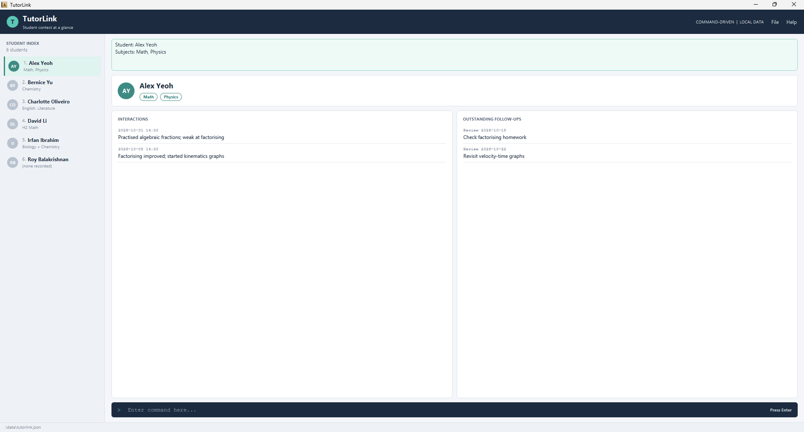

TutorLink is a **desktop app for private tutors who teach several students through recurring one-to-one lessons**. It keeps each student's subjects, dated notes on what happened in each lesson, and the things you want to revisit, all in one place. You use it by typing commands, so a tutor who types fast can find a student's context before a lesson in a few seconds.

TutorLink is for one tutor on one computer. It does not schedule lessons, track fees, keep grades or send messages.

* Table of Contents
{:toc}

--------------------------------------------------------------------------------------------------------------------

## Quick start

1. Ensure that Java `25` or later is installed on your computer.<br>
   **Mac users:** Ensure you have the precise JDK version prescribed [here](https://se-education.org/guides/tutorials/javaInstallationMac.html).

1. Download the latest `tutorlink.jar` from the [releases page](https://github.com/AY2627S1-CS2103-F12-2/tp/releases).

1. Copy the file to the folder you want TutorLink to keep its data in. This is TutorLink's _home folder_.

1. Open a terminal, `cd` to that folder, and run `java -jar tutorlink.jar`.<br>
   A window similar to the one below appears in a few seconds. The first time you start TutorLink, it contains some sample students.<br>
   

1. Type a command in the command box at the bottom and press Enter. Some commands to try:

   * `student add n/John Tan s/Math s/Physics` : Adds a student named John Tan who is taught Math and Physics.

   * `student view n/John Tan` : Shows John Tan's details.

   * `list` : Shows all your students.

   * `student delete n/John Tan` : Deletes John Tan.

   * `exit` : Exits the app.

1. See [Features](#features) below for the details of each command.

--------------------------------------------------------------------------------------------------------------------

## Features

<div markdown="block" class="alert alert-info">

**:information_source: Notes about the command format:**<br>

* Words in `UPPER_CASE` are parameters for you to fill in.<br>
  For example, in `student add n/NAME`, replace `NAME` with a name such as `John Tan`.

* Items in square brackets are optional.<br>
  For example, `n/NAME [s/SUBJECT]` can be used as `n/John Tan s/Math` or as `n/John Tan`.

* Items followed by `…` can appear any number of times, including zero.<br>
  For example, `[s/SUBJECT]…` can be left out, or written as `s/Math` or `s/Math s/Physics`.

* Parameters can be in any order unless a command's instructions say otherwise.<br>
  For example, `s/Math n/John Tan` works the same as `n/John Tan s/Math`.
  For `interaction add`, `note/` must be last because everything after it is note text.

* Command words are not case-sensitive. `Student Add` works the same as `student add`.

* Commands that take no parameters (`help`, `list` and `exit`) ignore anything typed after them.<br>
  For example, `help 123` is read as `help`.

* Every command that takes `n/NAME` finds the student by name, ignoring upper and lower case. `n/john tan` finds the student added as `John Tan`.

* If you are using a PDF version of this document, take care when copying commands that span several lines, because the spaces around line breaks may be lost.
</div>

### Viewing help: `help`

Opens a window with a link to this user guide.

Format: `help`

### Adding a student: `student add`

Adds a student, with the subjects you teach them.

Format: `student add n/NAME [s/SUBJECT]…`

* `NAME` is 1 to 50 characters long and contains at least one letter. It may use letters (including accented letters such as `é`), spaces, hyphens, apostrophes and full stops, so names such as `Mary-Jane O'Brien` and `Tan Ah Kow Jr.` are accepted.
* Each student's name must be unique, ignoring case. If `John Tan` exists, adding `john tan` is rejected as a duplicate.
* `SUBJECT` is 1 to 30 characters long and may use letters, digits, spaces, hyphens, `+` and `&`, for example `H2 Math` or `Biology + Chemistry`.
* A student can have any number of subjects, including none. Giving the same subject twice, in any case, is rejected.
* Subjects are shown in the order you type them.

Examples:
* `student add n/John Tan s/Math s/Physics`
* `student add n/Aliyah Lim`

On success, TutorLink shows the student and the new total:

```
✔ Student added: John Tan (subjects: Math, Physics)
Total students: 5
```

### Viewing a student: `student view`

Shows a student's name and subjects, and shows their interactions and follow-ups in the panels below.

Format: `student view n/NAME`

* The name is matched ignoring case, but it must otherwise be the full name. Use [`find`](#finding-students-by-name-find) if you only remember part of it.

Example:
* `student view n/john tan` shows the student added as `John Tan`.

### Listing all students: `list`

Shows all your students in the student list on the left.

Format: `list`

* Use `list` to show everyone again after a [`find`](#finding-students-by-name-find).

### Finding students by name: `find`

Shows only the students whose names contain any of the given words.

Format: `find KEYWORD [MORE_KEYWORDS]`

* The search ignores case. `john` matches `John`.
* Only whole words match. `Jo` does not match `John`.
* Students matching at least one word are shown. `find Tan Lim` shows both `John Tan` and `Aliyah Lim`.
* The student list shows `Showing 2 of 46` while the results are filtered. Type `list` to show everyone again.

Examples:
* `find tan` shows `John Tan` and `Tan Wei Ling`.
* `find john aliyah` shows `John Tan` and `Aliyah Lim`.

<!-- Interaction commands (interaction add, interaction list): @Dancodes2 -->

### Adding an interaction: `interaction add`

Records a dated note about a lesson or other discussion with an existing student.

Format: `interaction add n/NAME d/DATE [t/TIME] note/TEXT`

* `NAME` identifies an existing student by their full name, ignoring case.
* `DATE` must be a real calendar date in `yyyy-MM-dd` format, such as `2026-10-01`.
  A future date is allowed, but TutorLink warns you before recording it.
* `TIME` is optional. If given, it must use the 24-hour `HH:mm` format, such as `14:30`.
* `TEXT` is 1 to 500 characters long after leading and trailing whitespace is removed.
  It must not be blank and must be on a single line. If you paste text containing line breaks, each line break becomes a space,
  so a pasted `First line⏎Second line` is recorded as `First line Second line`.
  The limit counts Unicode code points: a simple emoji such as 😀 counts as one. A combined emoji or a letter with a combining accent can contain multiple code points and count as more than one.
* The `n/`, `d/` and optional `t/` parameters may appear in any order before `note/`.
  The `note/` parameter must be last. Everything after `note/` is treated as note text.
  Missing required parameters (`n/`, `d/`, or `note/`), repeated `n/`, `d/`, or `t/` parameters,
  and text before the first parameter are rejected.
* Multiple interactions may have the same date and time. Each note is recorded separately.
* A failed command leaves your stored data unchanged.

Examples:

* `interaction add n/John Tan d/2026-10-01 note/Discussed revision plan`
* `interaction add n/john tan d/2026-10-01 t/14:30 note/Practised algebraic fractions`
* `interaction add n/John Tan d/2026-10-15 note/Reviewed algebraic fractions`

After the first example, TutorLink shows:

```text
✔ Interaction recorded for John Tan on 2026-10-01.
Total interactions for John Tan: 1
```

If the interaction has a time, that time is included in the confirmation:

```text
✔ Interaction recorded for John Tan on 2026-10-01 (14:30).
Total interactions for John Tan: 2
```

If the date is in the future, TutorLink records the interaction and shows a warning first:

```text
⚠ Interaction date 2026-10-15 is in the future (today is 2026-10-14); recording it anyway.
✔ Interaction recorded for John Tan on 2026-10-15.
Total interactions for John Tan: 3
```

Invalid input examples:

* `note/` with no text is rejected with `Note cannot be empty.`
* A note longer than 500 characters is rejected with `Note must be 500 characters or fewer.`
* Repeated `n/`, `d/` or `t/` parameters before `note/` are rejected. A `note/` appearing
  after the first `note/` is retained as part of the note text.
* `d/01-10-2026` is rejected because the required format is `yyyy-MM-dd`.
* `d/2026-02-30` is rejected because February does not have 30 days.
* `t/25:00` is rejected because the time must be valid and use `HH:mm`.
* An unknown student is rejected with `No student named 'NAME' found.`

### Viewing a student's interactions: `interaction list`

Shows a student's interaction history in chronological order in the command result area.

Format: `interaction list n/NAME`

* Give the full name of an existing student, ignoring case, with `n/` exactly once.
* Interactions are sorted by date and then time, earliest first. On the same date, an interaction
  without a time and one at `00:00` share the same ordering position; their relative order follows
  the order in which they were recorded. Both appear before interactions at later times.
* Listing interactions does not change stored data or select a different student in the panels.
  Use `student view n/NAME` to select a student.

Example:

* `interaction list n/John Tan`

After recording the interactions above, the result is:

```text
Interactions for John Tan (3):
1. 2026-10-01 — Discussed revision plan
2. 2026-10-01 14:30 — Practised algebraic fractions
3. 2026-10-15 — Reviewed algebraic fractions
```

If John has no interactions, TutorLink shows `ℹ No interactions recorded for John Tan yet.`
An unknown student gives `No student named 'NAME' found.` Missing or repeated `n/` parameters
are rejected.

### Adding a follow-up: `followup add`

Records something you intend to revisit with an existing student, with a review date.

Format: `followup add n/NAME desc/TEXT review/DATE`

* `NAME` identifies an existing student by their full name, ignoring case.
* `TEXT` is 1 to 200 characters long after leading and trailing whitespace is removed. It must not be blank and must be on a single line. If you paste text containing line breaks, each line break becomes a space.
  The limit counts Unicode code points: a simple emoji such as 😀 counts as one. A combined emoji or a letter with a combining accent can contain multiple code points and count as more than one.
* `DATE` must be a real calendar date in `yyyy-MM-dd` format, such as `2026-10-15`. Past, present and future review dates are allowed.
* Give each parameter exactly once. Missing parameters or repeated prefixes are rejected.
* A follow-up belongs to the student. It does not need to be linked to an interaction.
* A duplicate with the same description and review date for the same student is rejected. Descriptions are compared after trimming and are case-sensitive: `Review algebra` and `review algebra` are different descriptions.
* A failed command leaves your stored data unchanged.

Examples (after adding John Tan):

* `followup add n/John Tan desc/Review algebra review/2026-10-15`
* `followup add n/john tan desc/Check in on extra drills review/2026-10-14`

After the first example, if John Tan has no other follow-ups, TutorLink shows:

```text
✔ Follow-up added for John Tan — review on 2026-10-15: "Review algebra"
Total outstanding follow-ups for John Tan: 1
```

Use `student view n/John Tan` to show John's follow-ups in the outstanding follow-ups panel. If John is already selected, the panel updates when you add a follow-up. Follow-ups are saved automatically and remain available after restarting TutorLink.

Invalid input examples:

* `desc/` with no text is rejected with `Description cannot be empty.`
* A description longer than 200 characters is rejected with `Description must be 200 characters or fewer.`
* `review/15-10-2026` is rejected because the required format is `yyyy-MM-dd`.
* `review/2026-02-30` is rejected because February does not have 30 days.
* An unknown student is rejected with `No student named 'NAME' found.`

### Viewing outstanding follow-ups: `followup list`

Shows a student's outstanding follow-ups in the command result area.

Format: `followup list n/NAME`

* Give the full name of an existing student, ignoring case, with `n/` exactly once.
* Follow-ups are numbered and sorted by review date, earliest first. Follow-ups with the same review date remain in the order they were added. The outstanding follow-ups panel uses the same ordering.
* Every recorded follow-up counts as **outstanding**, including those with past review dates. TutorLink does not yet have a command to complete or cancel a follow-up; passing its review date does not remove it.
* Listing follow-ups does not change stored data or select a different student in the panels. Use `student view n/NAME` to select a student.

Example:

* `followup list n/John Tan`

After adding the two examples above, the result is:

```text
Outstanding follow-ups for John Tan (2):
1. 2026-10-14 — Check in on extra drills
2. 2026-10-15 — Review algebra
```

If John has no follow-ups, TutorLink shows `ℹ No outstanding follow-ups for John Tan.` An unknown student gives `No student named 'NAME' found.` Missing or repeated `n/` parameters are rejected.

### Deleting a student: `student delete`

Deletes a student, together with all of their interactions and follow-ups.

Format: `student delete n/NAME`

* The name is matched ignoring case, as in `student view`.

<div markdown="span" class="alert alert-warning">:exclamation: **Caution:**
Deleting a student cannot be undone, and it also deletes every interaction and follow-up recorded for them.
</div>

<div markdown="span" class="alert alert-primary">:bulb: **Tip:**
To correct a student's name or subjects, delete the student and add them again. This also deletes their interactions and follow-ups.
</div>

Example:
* `student delete n/John Tan`

### Exiting the program: `exit`

Exits TutorLink.

Format: `exit`

### Saving the data

TutorLink saves your data to your computer after every command that changes it. You do not need to save manually.

### Editing the data file

TutorLink keeps its data in the JSON file `[JAR file location]/data/tutorlink.json`. Advanced users can edit this file directly.

<div markdown="span" class="alert alert-warning">:exclamation: **Caution:**
If your changes make the data file invalid, TutorLink starts with no students the next time it runs. The invalid file stays on disk until you run a command that changes data, which overwrites it. Back up the file before editing it.<br>
Some edits can also make TutorLink behave unexpectedly, for example a value outside the accepted range. Edit the data file only if you are confident you can update it correctly.
</div>

--------------------------------------------------------------------------------------------------------------------

## FAQ

**Q**: How do I move my data to another computer?<br>
**A**: Install TutorLink on the other computer and run it once. Then replace the `data/tutorlink.json` file it creates with the one from your old computer's home folder.

**Q**: How do I remove the sample students?<br>
**A**: Delete each one with `student delete n/NAME`. TutorLink only adds sample students when it starts without a data file.

--------------------------------------------------------------------------------------------------------------------

## Known issues

1. **When using multiple screens**, if you move TutorLink to a secondary screen and later switch to using only the primary screen, the window opens off-screen. To fix this, delete the `preferences.json` file in the home folder before running TutorLink again.
2. **If you minimize the help window** and then run `help` again (or use the `Help` menu, or press `F1`), the minimized help window stays minimized and no new one appears. Restore the minimized window manually.

--------------------------------------------------------------------------------------------------------------------

## Command summary

Action | Format, Examples
--------|------------------
**Add student** | `student add n/NAME [s/SUBJECT]…`<br> e.g., `student add n/John Tan s/Math s/Physics`
**View student** | `student view n/NAME`<br> e.g., `student view n/John Tan`
**List students** | `list`
**Find students** | `find KEYWORD [MORE_KEYWORDS]`<br> e.g., `find tan lim`
**Add interaction** | `interaction add n/NAME d/DATE [t/TIME] note/TEXT`<br> e.g., `interaction add n/John Tan d/2026-10-01 note/Discussed revision plan`
**List interactions** | `interaction list n/NAME`<br> e.g., `interaction list n/John Tan`
**Add follow-up** | `followup add n/NAME desc/TEXT review/DATE`<br> e.g., `followup add n/John Tan desc/Review algebra review/2026-10-15`
**View follow-ups** | `followup list n/NAME`<br> e.g., `followup list n/John Tan`
**Delete student** | `student delete n/NAME`<br> e.g., `student delete n/John Tan`
**Help** | `help`
**Exit** | `exit`
